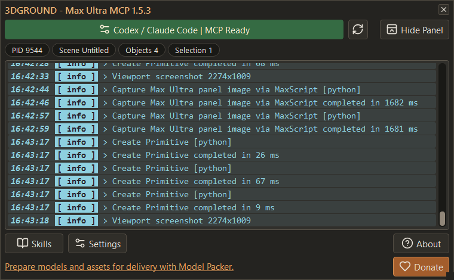

# 3DGROUND - Max Ultra MCP

Max Ultra MCP lets an AI agent work inside Autodesk 3ds Max. Connect ChatGPT Desktop (Codex mode), Codex, Claude Code, Antigravity, or another MCP client, then ask in plain language: "create a teapot in 3ds Max", "build this floor plan", "render the scene from the front camera". The agent creates and edits objects, organizes layers, captures the viewport to check its own work, starts renders, and runs MaxScript when no dedicated tool exists. All 3ds Max work runs on the Max main thread.



**[Download from the MaxPkg catalog](https://maxpkg.dev/catalog/max-ultra-mcp)** · [GitHub Releases](https://github.com/maxpkg-dev/max-ultra-mcp/releases) · [Changelog](CHANGELOG.md) · [Troubleshooting](#troubleshooting)

## Requirements

- Windows with Autodesk 3ds Max 2022 through 2027.
- [MaxPkg](https://maxpkg.dev) to install the `.mzp` package.
- One MCP client: the ChatGPT desktop app in Codex mode, Codex, the Claude desktop app (**Code > Local**), Antigravity, or another STDIO MCP client.

Release packages bundle a portable Node.js runtime. Users do not install Node.js, change `PATH`, need administrator rights, or download dependencies at runtime.

## Installation for release users

1. Download the Max Ultra MCP `.mzp` from the [MaxPkg catalog](https://maxpkg.dev/catalog/max-ultra-mcp) and install it through MaxPkg.
2. In every 3ds Max process that should connect, run this file once:

   ```maxscript
   01_START_MAX_ULTRA_MCP_FIRST.ms
   ```

   The main panel opens. When no supported AI client is configured yet, **AI Client Setup** opens automatically about two seconds later.
3. In AI Client Setup, click your client and follow its steps below.
4. Restart or reconnect the AI client, then click **2. Test prompt** and paste the copied read-only test into a new conversation.

The green status button names the clients whose registration is ready. **Configured** confirms registration, not a live chat connection.

### ChatGPT Desktop and Codex

> **ChatGPT Desktop users: switch to Codex mode before using Max Ultra MCP.** Run the connection test and all 3ds Max requests in Codex mode. Ordinary ChatGPT mode does not expose this local MCP connection. A green **MCP ready** status confirms registration, not the mode or tool access of the current conversation.

1. Click **Codex**. When the Codex CLI is missing, the button offers **Install Codex** and asks for confirmation before running the official installer. When the desktop app is missing, its official download page opens; install it and click Refresh status.
2. Click **Connect to Codex**. ChatGPT Desktop and Codex share the same OpenAI MCP configuration.
3. Optional, for natural-language routing: install the packaged plugin once. `<INSTALL_ROOT>` is the Max Ultra MCP package folder, the folder that contains `01_START_MAX_ULTRA_MCP_FIRST.ms`.

   ```powershell
   codex plugin marketplace add "<INSTALL_ROOT>"
   codex plugin add max-ultra-mcp@3dground-max-ultra-mcp
   ```

   Start a new task after installation. Requests in any language, such as "create a teapot in 3ds Max", then activate the Max Ultra MCP workflow automatically.

### Claude Code

Open the Claude desktop app, sign in, and use **Code > Local** on this Windows computer. Terminal chat is not required. Ordinary Chat, Cowork, Cloud, and WSL sessions are outside this setup.

1. Click **Claude Code**. When the Claude Code CLI is missing, the button offers **Install Claude Code** and asks for confirmation before running the official installer.
2. Click **Connect to Claude Code**. Registration is user-scoped and uses the official `claude mcp` command.
3. Reopen the local Code session and run **Test prompt**.

### Antigravity

Click **Antigravity**. When it is not installed, its official page opens; there is no CLI step. When it is available, **Connect to Antigravity** backs up its settings and updates only the Max Ultra MCP server entry. See [Antigravity setup](docs/ANTIGRAVITY.md).

### Other MCP clients

Open the **Manual setup** tab to view and copy the exact STDIO command, arguments, and environment values for any other client.

### If setup does not open

Open it through the aggregate status button or **Settings -> Open AI client setup**. Closing onboarding only dismisses it for the current run; it does not stop the bridge. A failed readiness check stays visible as **Check failed** and does not open setup; failed CLI probes show an error and require Refresh status. See [CLI installation and diagnostics](docs/README.md#cli-installation) for installer sources, cancellation, account steps, and verification limits.

## Your first requests

Once the test prompt succeeds, ask in your own words:

- "Create a one-meter cube in 3ds Max and show me the viewport."
- "Group the scene into layers by object type."
- "Find objects with missing or broken materials."
- "Build a house shell from this attached floor plan." See [First AI-assisted house plan](#first-ai-assisted-house-plan).
- "Render the current view and show me the result."

The agent starts by finding your open 3ds Max. With several open, it selects one by version or scene, or asks you which one to use.

## What users can do

- Start the bridge and configure ChatGPT Desktop, Codex, Claude Code, Antigravity, or another STDIO client from one MaxScript entry point.
- Connect one or more already-open 3ds Max instances to one local bridge.
- Let each connected MCP client select its own Max instance.
- Inspect and modify scenes through structured MCP tools.
- Organize layer hierarchies, membership and properties with [semantic layer tools](docs/LAYERS.md), including explicit preview/apply for merge, deletion and empty-layer cleanup.
- Validate and create custom Editable Poly topology from object-local vertices and zero-based polygon faces.
- Maximize the active viewport, temporarily clean and improve its display, capture it, restore the user's display settings, and return the screenshot directly to the model.
- Start, monitor, cancel, and retrieve renders.
- Monitor, wait for, cancel, and retrieve any session-owned long operation through the common job API.
- Find geometry with missing, invalid, unsupported, incomplete Multi/Sub, or missing-bitmap material assignments without changing selection.
- Run MaxScript text, files, macros, and Action Table commands.
- Inspect, diagnose, and capture top-level or child UI only inside the selected `3dsmax.exe` process.
- Validate and build a dimensioned house plan interpreted from an attached image.
- Use unrestricted `max_execute` when a semantic tool does not exist yet.

### Tool profiles

- `core`: connection, scene, objects, viewport, rendering, scripts, diagnostics, UI automation, and layers.
- `archviz`: core plus materials and structured floor-plan workflows.
- `full`: archviz plus modifiers, import/export, and animation helpers.

Set the profile with `MAX_ULTRA_MCP_TOOL_PROFILE`. The default is `archviz`.

## The panel

### Main panel

The top row holds the AI client status, refresh and **Hide panel**. Below it, badges show the process PID, scene, object count and selection count; click a badge to copy its value. The Activity journal lists every operation the agent runs. **Skills**, **Settings**, **About** and **Donate** sit at the bottom.

- **Refresh** reconnects the bridge, then checks AI client status.
- **Hide panel** keeps the connection and logging in a compact green, amber or red status button. Expanding restores the panel's position and size.
- Closing the main window stops the script.
- The journal supports search, filters, copying and export of the full session history. Autoscroll follows the newest entries only while you are at the bottom.
- The panel is resizable: buttons become compact icons at small widths and grow on large screens. Window position and size persist within the monitor work area, and all owned windows follow Max rather than staying above other applications.

After the first successful connection, the journal shows at most three support reminders (after one minute, then ten and 60 minutes later). The footer rotates product and website links beside Donate. See [UI design](docs/UI_DESIGN.md) for component behavior and source locations.

### Skills manager

**Skills** opens a separate manager. View built-in workflows, copy a creation prompt into a successful AI conversation, browse community skills, and import an instruction-only custom skill folder or ZIP in one action. Import validates the package before saving it and publishes discovery adapters for Codex, Claude Code, and Antigravity; `max_skills_list` and `max_skill_read` expose the content without needing Max connected. Custom skills stay in `%LOCALAPPDATA%\3DGROUND\MaxUltraMCP\user-skills` across updates. See the [local HTML manual](docs/CUSTOM_SKILLS.html) and [submission guide](docs/SUBMIT_SKILL.html).

### Settings and themes

Settings offers seven editable themes, including the user's 3ds Max colorMan palette, and 20-100% panel opacity. Changes apply immediately to open windows. AI Client Setup distinguishes runtime check failures from missing files; see [runtime diagnostics](docs/README.md#ai-runtime-diagnostics).

### Automatic updates

Update checks are on by default. Only a stable official GitHub Release with a matching package and checksum is accepted; it installs through MaxPkg and Max Ultra MCP restarts itself. A failed check or download leaves the installed version untouched. Use **Check now** in Settings, or turn automatic checks off there. Downloads run in a hidden helper process, so they never block 3ds Max. See [update migration](docs/MAXPKG.md#transition-from-147-to-150) before updating from 1.4.x.

## Optional agent skills

Skills teach the agent proven workflows. The MCP server is fully usable without them, and installing them is client-specific and never required for bridge startup or onboarding. The release includes nine:

| Skill | Use it for |
|---|---|
| [`max-ultra-mcp`](skills/max-ultra-mcp/SKILL.md) | general 3ds Max control and MaxScript code rules |
| [`max-ultra-camera-composition`](skills/max-ultra-camera-composition/SKILL.md) | Safe Frame-aware camera placement |
| [`max-ultra-character-object-modeling`](skills/max-ultra-character-object-modeling/SKILL.md) | reference-driven single-mesh subdivision modeling |
| [`max-ultra-armchair-modeling`](skills/max-ultra-armchair-modeling/SKILL.md) | chair and armchair reconstruction with component likeness checks |
| [`max-ultra-renderer-settings`](skills/max-ultra-renderer-settings/SKILL.md) | runtime-inspected renderer configuration |
| [`max-ultra-spline-modeling`](skills/max-ultra-spline-modeling/SKILL.md) | paths, profiles and non-destructive modifier sources |
| [`max-ultra-floor-plan`](skills/max-ultra-floor-plan/SKILL.md) | dimensional image or drawing to model, with a preserved wall spline |
| [`max-ultra-small-house-detailing`](skills/max-ultra-small-house-detailing/SKILL.md) | small-house scenes from plans through roofs, cladding and fitted furnishings |
| [`max-ultra-maxpkg-packaging`](skills/max-ultra-maxpkg-packaging/SKILL.md) | adapting new or existing 3ds Max scripts to the official MaxPkg workflow |

The small-house detailing skill also supports detailing an existing house; it does not produce construction documentation. It reuses the floor-plan, camera, and renderer skills and adds no MCP tools. The MaxPkg skill resolves the current official repository commit at execution time, reads its prompts and automation API documentation from GitHub, and prepares every project with the matching original `maxpkg-packager.ms`, `_install.ms`, and `_uninstall.ms`. The general skill loads its packaged MaxScript code rules before creating or editing reusable scripts; target-project rules take precedence when they are stricter.

For ChatGPT Desktop and Codex, the `plugins/max-ultra-mcp` plugin packages the same nine skills through the `3dground-max-ultra-mcp` marketplace (see [installation step 3](#chatgpt-desktop-and-codex)). The plugin supplies workflow routing; the registered local MCP server remains the tool transport. The installer does not modify an agent's skill directory automatically.

## First AI-assisted house plan

The complete image-to-scene example is in [examples/house-plan-from-image](examples/house-plan-from-image/README.md).

1. Attach `plan-example.png` to ChatGPT or Codex.
2. Send the English prompt from `PROMPT.md`.
3. The model interprets dimensions into structured JSON.
4. MCP validates the plan and returns a validation token.
5. MCP creates and preserves a wall-plan source spline, extrudes a separate copy, builds outward-facing opening-aware wall topology through `meshOp`, joins walls without penetration, and adds the expanded floor in one undo transaction.
6. The model captures top and perspective viewport screenshots, optionally performs a reversible Normal-modifier A/B comparison, and verifies the result without leaving opening helpers.

The source image is interpreted by the model. Raw image bytes are not passed to 3ds Max.

## Troubleshooting

- If ChatGPT says Max Ultra tools are unavailable while the bridge shows **MCP ready**, first **switch to Codex mode** and run the connection test there. The `archviz` profile already includes `max_list_instances`, `max_health`, `max_scene_summary`, and `max_capture_viewport`.
- If several Max instances are connected, select one explicitly.
- If the daemon was stopped, rerun `01_START_MAX_ULTRA_MCP_FIRST.ms`. Automatic launches are hidden by default; enable the visible server console in Settings when diagnosing startup.
- `BRIDGE_DOWN` means the local daemon is unavailable. The STDIO host remains usable, so rerun the first-step script and retry after the daemon returns. If the failure interrupted a mutation, inspect fresh scene state before retrying it.
- `MAX_NOT_CONNECTED` means no live bootstrap is connected.
- `RENDERER_UNSUPPORTED` means the active renderer or plugin version lacks a verified adapter for the requested operation.
- Seeing one `node.exe --stdio` per connected ChatGPT, Codex, Claude Code, or other MCP session is expected. `node_repl.exe` processes belong to the AI client, not Max Ultra MCP. Close/reconnect the corresponding AI task to remove an idle client-owned host.
- Helper launchers resolve Windows PowerShell from Windows system directories without PATH lookup; a 32-bit process uses Sysnative when available. Missing executable and unavailable package working-directory diagnostics identify different failures; neither message alone proves an antivirus issue.
- PowerShell 7 is not required. Normal scripts use Windows PowerShell 5.1.
- Cancelling the standard standalone installer during an automatic update can require reinstalling the MZP.

For detailed endpoint recovery and panel behavior, see [docs/README.md](docs/README.md).

## Security model

- Network listeners bind to `127.0.0.1` only.
- Local control requests use a random installation token.
- Committed documentation, fixtures, logs, and media use synthetic or anonymized data; see the privacy policy.
- STDOUT from the MCP host contains only JSON-RPC; logs go to STDERR or log files.
- Scene mutations are serialized through the Max main-thread queue.
- UI Automation rejects every HWND not owned by the selected `3dsmax.exe` process.
- Arbitrary MaxScript is intentionally powerful and is annotated as a destructive, open-world operation for client approval.
- Unknown renderer APIs return explicit unsupported errors instead of reporting false success.
- Native code is never required for normal operation. Any future managed or native helper must be package-local, optional, and covered by a Node.js/MaxScript fallback.

## How the connection works

```text
ChatGPT Desktop / Codex / Claude Code / other MCP client
        | MCP JSON-RPC over STDIO
        v
MCP host: core/server.js --stdio
        | authenticated loopback control protocol
        v
Bridge daemon: core/server.js --daemon
        | persistent TCP on 127.0.0.1
        v
MaxScript bootstrap in each 3ds Max process
        | bounded main-thread queue
        v
3ds Max scene, viewport, renderer, and Max-owned UI
```

One daemon can serve several MCP clients and several Max processes. Selection is stored per MCP client. Exactly one connected Max routes automatically; multiple connected instances require `max_list_instances` followed by `max_select_instance`.

Each connected AI-client session normally owns one `core/server.js --stdio` process. These are not extra daemons. Re-running the first-step file may replace the daemon when it is not shared by another open Max, but the client-owned STDIO host remains alive. Its next tool call waits up to ten seconds for a verified daemon on the same configured loopback endpoint and reconnects without another MCP initialization. Interrupted calls are never replayed automatically because a mutation may already have reached Max. A changed fallback port or newly installed STDIO runtime still requires reconnecting the AI client. Max Ultra MCP never terminates `node_repl.exe`, unrelated Node.js processes, or an endpoint whose identity cannot be verified.

## For developers and agents

### Project status

The v1 architecture and MCP surface are implemented. The automated suite covers the 3ds Max 2022 and 2027 protocol endpoints, multi-instance routing, authenticated STDIO transport, structured responses, viewport images, render jobs, UI boundaries, and floor-plan generation. Mock endpoints do not replace testing on real 3ds Max and renderer versions, which each release still needs.

The remaining workflow backlog includes asset relinking and collection, Corona/V-Ray configuration, camera composition, render masks, batch FBX/GLB export, performance analysis, proxy conversion, and AI-assisted material editing. See [Required Production Use Cases](docs/USE_CASES.md).

### Agent workflow

An agent using the packaged skill routes requests such as "create a one-meter cube in 3ds Max", "fix the layout in my 3D program", or "render this in the 3D editor" to Max Ultra MCP and begins with instance discovery:

1. Call `max_list_instances({})`.
2. When exactly one instance is returned, call `max_select_instance({"instance_id":"<INSTANCE_ID>"})`. When several are returned, select a uniquely identified version or scene; otherwise ask one short question. When none are returned, ask one short connection question and do not mutate a scene or UI.
3. Perform the narrowest semantic operation.
4. Query the post-state and capture the relevant viewport, render, or window.

For a Max-owned tool window, use this compact inspection loop:

```text
max_list_instances -> max_select_instance
max_ui_list_windows -> max_ui_inspect
max_ui_capture_window({ window: { hwnd: <HWND> } })
max_ui_diagnostics({ window: { hwnd: <HWND> }, maxDepth: 5, limit: 200 })
narrow semantic tool or reviewed max_run_script
max_ui_inspect -> max_ui_capture_window / max_ui_diagnostics
```

A supplied HWND is captured through the native Windows path after selected-process ownership is revalidated, so child and MAXScriptDialog windows do not need to be rediscovered through UI Automation. Diagnostics return bounded UI Automation and native HWND trees plus compact MSHTML WebBrowser DPI, zoom, DOM-count, layout, and scroll metrics when available; they do not return raw DOM or page source.

### Development checkout

Requirements:

- Windows with Windows PowerShell 5.1.
- Node.js 22 or newer, unless `runtime\win-x64\node.exe` has been prepared.
- Autodesk 3ds Max only for real integration testing; mock tests do not launch Max.

The Python fixtures in `tests/` exercise runtime behavior and Qt layouts with isolated state. The release fixture launches only in an explicitly dedicated, empty Max process and isolates package and user-data directories. Mock or standalone Qt results do not prove real-client or renderer compatibility.

Start the bridge daemon:

```powershell
node .\core\server.js --daemon
```

Register the development STDIO host:

```powershell
codex mcp add max-ultra-mcp --env MAX_ULTRA_MCP_TOOL_PROFILE=archviz -- node "<PROJECT_ROOT>\core\server.js" --stdio
```

Then run `01_START_MAX_ULTRA_MCP_FIRST.ms` inside 3ds Max. The source-only `scripts\install-chatgpt-codex.bat` remains available to developers; release installation uses MaxPkg and the first-start window.

### Verification

Run all mock, contract, and CLI integration suites:

```powershell
powershell.exe -NoProfile -ExecutionPolicy Bypass -File .\scripts\run-smoke.ps1
```

The suites never open, modify, or save a real 3ds Max scene. Before a production release, also test real 3ds Max versions and installed Corona/V-Ray adapters using the acceptance fixtures described in [USE_CASES.md](docs/USE_CASES.md).

### Read-only diagnostics CLI

The source checkout includes a developer/agent diagnostics launcher:

```powershell
& ".\diagnostics\Max Ultra MCP Diagnostics.bat" --help
& ".\diagnostics\Max Ultra MCP Diagnostics.bat" status
& ".\diagnostics\Max Ultra MCP Diagnostics.bat" skills
& ".\diagnostics\Max Ultra MCP Diagnostics.bat" skills --check
& ".\diagnostics\Max Ultra MCP Diagnostics.bat" health
& ".\diagnostics\Max Ultra MCP Diagnostics.bat" capabilities
```

The launcher starts `core\cli.js` with the bundled Node.js runtime when present, falls back to development Node.js, and forwards the requested command. It does not start a second MCP server, register a client, install a skill, execute MaxScript, change a scene, capture a viewport, or save a file.

`status` probes the official Codex and Claude Code CLIs with their read-only `mcp get`/`mcp list` commands and checks the existing authenticated daemon connection. `setup` prints exact `codex mcp add` and `claude mcp add --scope user` commands for review but never runs them. `skills` discovers every `skills\*\SKILL.md` folder without a fixed catalog, returns its name, description, and path, and extracts the MCP tool names referenced by its Markdown files. `skills --check` compares those references with live `max_capabilities`; the CLI helps an agent discover and verify a workflow, while the agent and MCP tools still execute it.

The batch launcher is intentionally source-only and excluded from the MaxPkg production allowlist. The underlying read-only `core\cli.js` remains package-local for agent diagnostics.

### Packaging and releases

The source repository does not contain the portable Node.js binary. Maintainers create it with `scripts\prepare-portable-node.ps1`, then prepare the pinned MaxPkg Packager project with `scripts\prepare-maxpkg.ps1`.

Maintainers set the intended release in `version.ini`, then run `PREPARE_RELEASE.bat` to synchronize Node metadata, promote reviewed `CHANGELOG.md` entries, regenerate MaxPkg settings with the permanent `Free` license, and run verification. `-Version <VERSION>` remains an optional override. The installed UI reads the packaged `manifest.ini` version, with `version.ini` as the source-checkout fallback. MZP build, commits, push, and publishing remain explicit maintainer steps. See [MaxPkg packaging](docs/MAXPKG.md#prepare-a-versioned-release).

### Documentation

- [V1 architecture, MCP integration, and tool behavior](docs/V1.md)
- [Required production use cases and acceptance contracts](docs/USE_CASES.md)
- [Privacy and data sanitization policy](docs/PRIVACY.md)
- [Detailed bootstrap, panel, lifecycle, and example documentation](docs/README.md)
- [UI design](docs/UI_DESIGN.md)
- [Portable runtime layout](runtime/README.md)
- [Experimental single-executable packaging](docs/SEA.md)
- [MaxPkg packaging and lifecycle](docs/MAXPKG.md)
- [Instructions for AI coding agents](AGENTS.md)

### Repository layout

```text
01_START_MAX_ULTRA_MCP_FIRST.ms   user-facing 3ds Max bootstrap
core/                             MCP host, daemon, and production tool runtime
python/                           in-Max Python/Qt controller and windows
tests/                            automated suites, helpers, and real-Max fixtures
skills/                           canonical agent skills and focused references
plugins/max-ultra-mcp/            ChatGPT and Codex natural-language routing plugin
scripts/                          launch, installation, packaging, UI helpers
examples/                         runnable and acceptance examples
docs/                             architecture, product specifications, and README images
runtime/                          portable runtime location in release builds
assets/                           source-controlled MaxPkg icon artwork
AGENTS.md                         repository contract for AI coding agents
```

## Thanks

Thank you to the contributors who share skills, workflows, and practical experience to improve Max Ultra MCP.

- **Yuriy Bobak**: Provided the architectural skills adapted into the small-house workflow and camera-basis checks.
